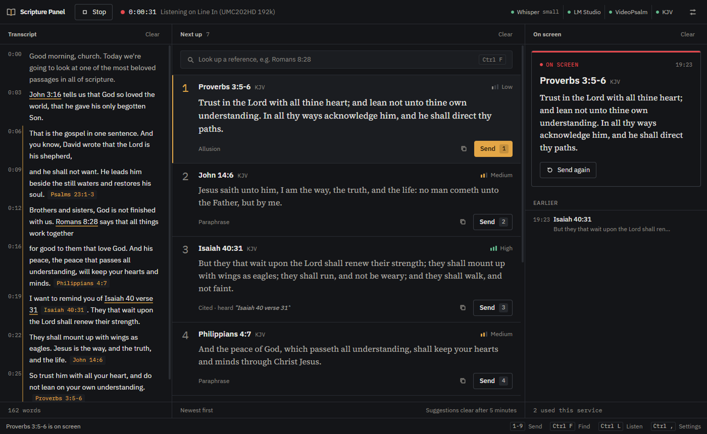
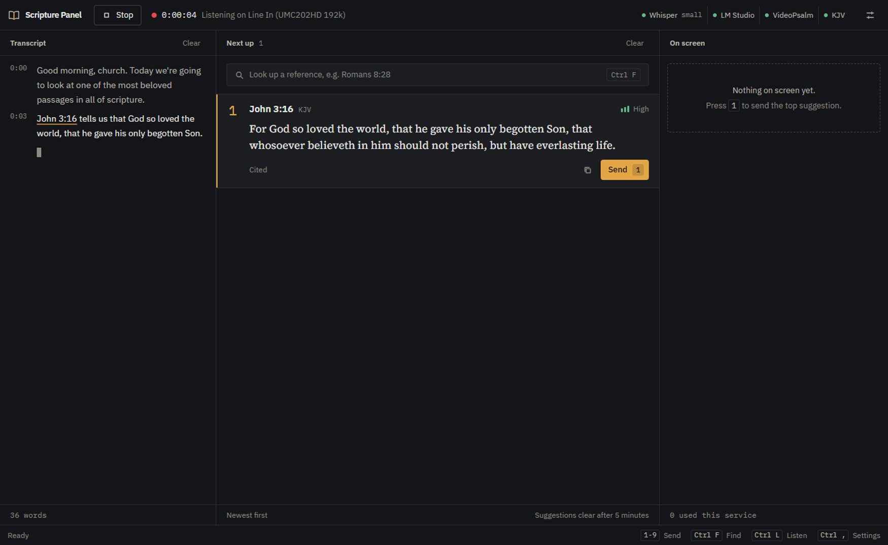

# User guide

Written for the rest of our media team, and for anyone who takes the desk during a service. You do not need to know how the app works inside to use it well.

## Contents

- [The screen at a glance](#the-screen-at-a-glance)
- [Before the service](#before-the-service)
- [During the service](#during-the-service)
- [Reading a card](#reading-a-card)
- [When a verse is missed](#when-a-verse-is-missed)
- [After the service](#after-the-service)
- [Shortcuts](#shortcuts)
- [Troubleshooting](#troubleshooting)

---

## The screen at a glance



| Area | What it shows |
|---|---|
| **Top bar** | Listen or Stop, how long you have been listening, and whether Whisper, LM Studio, VideoPsalm and the Bible are ready |
| **Transcript** (left) | What the preacher said, with times. Words that named a verse are underlined. |
| **Next up** (middle) | Verses the app thinks are coming, newest at the top. The top one is always key `1`. |
| **On screen** (right) | What the congregation is looking at now, with a red bar, and what was shown earlier |
| **Status bar** (bottom) | The last thing that happened, and the shortcuts |

## Before the service

1. Open VideoPsalm and choose the Bible you project from (KJV, NKJV...). It can stay behind our window; the app opens its Bibles tab when it needs it.
2. Open Scripture Panel. Press `Ctrl+,` for settings.
3. Choose the **input device** that carries the pulpit microphone. This is the most common mistake, so check it every time.
4. Leave the **Whisper model** on **Automatic**. It picks the best model for the graphics card, or a smaller one on a PC without one.
5. Close settings and press **Listen** (`Ctrl+L`). Say a sentence into the pulpit mic and check that words appear in the transcript.

Your choices are saved, so next week you can usually go straight to step 5.

**Is LM Studio needed?** No. Without it the app still catches every verse that is named out loud ("Romans 8:28"). With it, the app also catches verses that are quoted or paraphrased without being named.

### Two screens: the stream and the projector

When the stream laptop and the projection laptop each run VideoPsalm, one Scripture Panel can put a verse on both with one keypress. The panel runs on the stream laptop (it has the graphics card and the microphone feed); the projection laptop runs a small receiver.

Once, on the projection laptop:

1. Copy `Scripture Panel Receiver.exe` to it (any folder, for example the Desktop). Nothing else needs installing.
2. Open it. Windows Firewall asks once: allow it on **Private** networks. Set that laptop's network to Private if it is not.
3. Its window shows two things to copy: the **Projection laptop address** (for example `192.168.1.128:8765`) and the **Receiver key**.

Once, on the stream laptop: in Scripture Panel, open Settings (`Ctrl+,`), go to **VideoPsalm**, enter the address and key, and press **Save and test**. It should say "Connected". A **Projector** light then shows in the top bar.

Each service: open VideoPsalm and the receiver on the projection laptop and leave the receiver's window open. Sending, switching Bible (`T`), hiding the text (`Ctrl+Alt+0`) and blanking (`Ctrl+Alt+B`) then act on both screens. Untick either screen in Settings to send to the other only. If one laptop does not answer, the other still updates and the status bar names the one that failed.

## During the service

- When a verse appears at the top of **Next up**, check the reference and press `1`. It goes straight into VideoPsalm and moves to **On screen**, showing the verse as VideoPsalm shows it, in its translation. If VideoPsalm shows a different verse, a warning says so.
- If the verse you want is lower down, press its number (`2` to `9`).
- To send something shown earlier again, hover it under **Earlier** and click the resend icon.
- Not sure where a card came from? Point at it. The transcript highlights the line and words it was detected from.
- When the preacher asks for a translation ("read it from the NIV"), a bar says **Preacher asked for NIV**. Press **Switch** or `T` and VideoPsalm changes to that Bible, and the verse on screen is shown again in it. Nothing changes until you press. The Bible must be one of VideoPsalm's favourites (the buttons above its Bible list).

### Working from VideoPsalm: the mini panel

You do not need the full window open. Click **Mini panel** in the top bar once (it is remembered) and a small panel sits on VideoPsalm's window, over its Agenda area:

- It shows the top suggestions with their numbers, what is on screen and in which translation, and translation requests.
- Click a suggestion, or click the panel and press `1` to `9`, to send it. `T` switches Bible, `Ctrl+L` starts or stops listening.
- Drag it by its title strip to wherever suits your layout; it remembers the spot relative to VideoPsalm and follows VideoPsalm when it moves.
- It shows over VideoPsalm and over OBS, each with its own remembered spot, and hides over any other program.
- With the `Ctrl+Alt` keys you can stay in OBS the whole time: send a verse, hide it, blank the screen or switch Bible without switching windows. Fewer window switches also means less lag on the laptop.
- `_` folds it down to its title strip. **Full** brings back the full window.

The full window can stay minimised behind VideoPsalm the whole service; it does the work for the panel.

Clicking a card without pressing Send marks it as used (it goes to Earlier) without putting it on screen. This is useful if you put the verse up another way.

## Reading a card



- **Number** on the left: the key that sends it.
- **Reference and verse** in KJV.
- **Confidence**, shown as bars and a word:
  - **High**: the verse was named clearly ("John 3:16", "John 3 verse 16"), or you typed it.
  - **Medium**: named without a clear verse separator ("John 3 16"), or a close paraphrase.
  - **Low**: only a chapter was named ("Romans 8"), or a loose allusion. Check before sending.
- **Source** at the bottom: Cited, Paraphrase, Allusion, or Typed by operator. For cited verses it also shows what was heard, for example *heard "Isaiah 40 verse 31"*.

## When a verse is missed

Press `Ctrl+F`, type the reference and press Enter. All of these work:

```text
John 3:16
Romans 8:28-30
first corinthians 13 verse 4
2 tim 3 16
```

It appears at the top as card `1`, marked "Typed by operator". Press `1` to send it.

If the box turns red, the text could not be read as a reference. The reason is shown right under the box.

## After the service

Press **Stop** (`Ctrl+L`). The On screen panel keeps the list of verses used, which is handy if someone asks for the references later. **Clear** empties it.

## Shortcuts

| Key | Action |
|---|---|
| `1` to `9` | Send that card to VideoPsalm (also in the mini panel) |
| `T` | Switch VideoPsalm to the translation the preacher asked for |
| `Ctrl+Alt+1` to `9` | From any program, OBS included: send that card to VideoPsalm |
| `Ctrl+Alt+0` | From any program: hide or show the verse text on screen |
| `Ctrl+Alt+B` | From any program: screen off or on |
| `Ctrl+Alt+T` | From any program: switch to the translation asked for |
| `Ctrl+Alt+P` | From any program: fold or unfold the mini panel |
| `Ctrl+F` | Jump to the lookup box |
| `Ctrl+L` | Start or stop listening |
| `Ctrl+,` | Open or close settings |
| `Esc` | Dismiss a message or close settings. It never clears your suggestions. |

## Troubleshooting

| What you see | What to do |
|---|---|
| "Python not found" in the status bar | Python is not installed or not on PATH. Ask whoever set up the PC, or see the [development guide](development.md). |
| No devices in the input list | Check Windows microphone privacy settings. Speaker "loopback" devices are hidden on purpose. |
| Listening, but the transcript stays empty | Wrong input device, or the signal is very quiet. Check the mixer send to the PC. |
| Verses arrive too late | Switch to a smaller Whisper model in settings. |
| "Transcription is falling behind" | The model is too heavy for this PC. Stop, choose a smaller model, start again. |
| **KJV missing** in the top bar | The Bible database was not built. Run `npm run setup-bible` once. |
| **LM Studio off** | Fine if you do not use it. Otherwise start the server in LM Studio and load a chat model. |
| "VideoPsalm is not open" | Open VideoPsalm 1.29 or later. It does not need to be in front. |
| "VideoPsalm did not respond" | The bridge restarts itself, so try again. If it keeps happening, restart VideoPsalm. |
